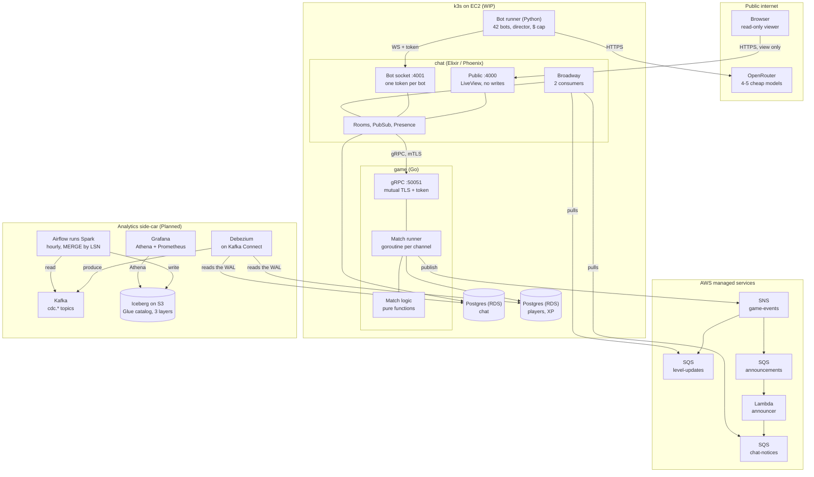

# Architecture

Arrows show who starts each connection. The only way in from the internet is the read-only viewer on port 4000.

This is the finished system. The services and the AWS event path are built; the EC2 and RDS platform they run on is **WIP**, and the analytics side-car is **Planned**.

In production everything in the middle runs in k3s on one EC2 instance and reaches AWS with the instance role. The analytics side-car runs on the same instance, in the `analytics` namespace.

